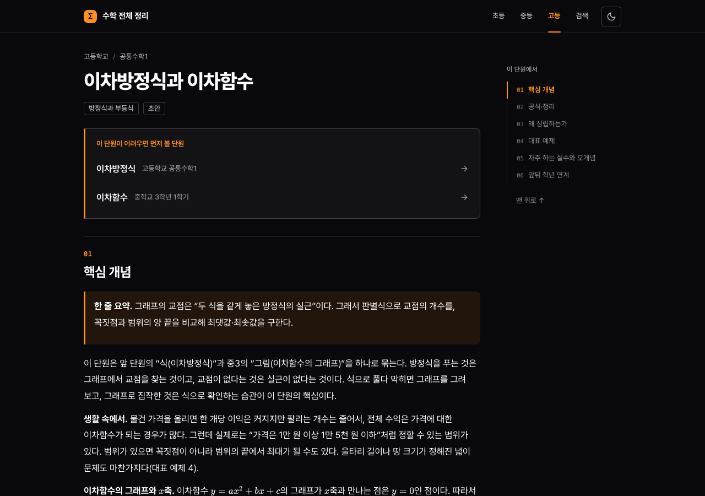

<div align="center">

# 수학 전체 정리 · K12-math

**초등 1학년부터 고등 3학년까지, 막히면 앞 학년으로 되돌아가는 수학 정리 사이트**

2022 개정 교육과정 기준 · 개념, 공식, 증명, 예제, 오개념을 단원마다 같은 틀로

<picture>
  <source media="(prefers-color-scheme: light)" srcset="docs/screenshots/home-light.png">
  
</picture>

</div>

| 항목 | 내용 |
| --- | --- |
| 기간 | 2026.10 ~ (모션 업그레이드 2026-11-04) |
| 역할 | 개인 프로젝트 |
| 기술 스택 | Astro 7 · Markdown + frontmatter · KaTeX · Pagefind · Motion · Anime.js |
| 배포 | GitHub Pages (`main` 푸시 시 validate → build → 배포). 공개 주소 `https://seung1won-dot.github.io/K12-math/`는 준비 중 |
| 상태 | 119단원 초안 완료 · 검토 완료 0 |
| 라이선스 | 콘텐츠 CC BY-NC-SA 4.0, 코드 MIT (확정 전) |

## 목차

- [이 사이트는 무엇인가](#이-사이트는-무엇인가)
- [이런 분께 도움이 됩니다](#이런-분께-도움이-됩니다)
- [주요 기능](#주요-기능)
- [지금 어디까지 왔나](#지금-어디까지-왔나)
- [시작하기](#시작하기)
- [프로젝트 구조](#프로젝트-구조)
- [더 읽을거리](#더-읽을거리)

## 이 사이트는 무엇인가

수학은 앞 내용을 모르면 다음 내용이 안 되는 과목입니다. 고1 이차함수가 어려운 이유는 대부분 고1에 있지 않습니다. 중3 이차함수, 중2 일차함수, 더 내려가면 초6 비례식에서 이미 구멍이 나 있는 경우가 많습니다.

이 사이트는 대학 입학 전에 배우는 수학을 **학년·학기·단원 순으로 한곳에 모으고, 단원끼리 "먼저 볼 단원"과 "다음 단원"으로 이어 둔 것**입니다. 막힌 단원에서 출발해 링크를 따라 거꾸로 내려가면, 어디서부터 다시 읽어야 하는지 스스로 찾을 수 있습니다.

```text
고1  이차방정식과 이차함수
 └─ 중3  이차함수
     └─ 중2  일차함수와 그래프
         └─ 중1  정비례와 반비례
             └─ 초6  비례식과 비례배분
```

> 위 연결은 실제 단원 데이터(`prerequisites`)를 그대로 따라간 것입니다.

## 이런 분께 도움이 됩니다

| 누가 | 어떻게 쓰면 좋은가 |
| --- | --- |
| **수학이 막힌 중·고등학생** | 지금 배우는 단원을 열고, 맨 위 "이 단원이 어려우면 먼저 볼 단원"부터 거슬러 읽습니다. |
| **공식을 외우기만 하고 이유를 모르는 학생** | 단원마다 있는 "왜 성립하는가"에서 공식이 어디서 나왔는지 확인합니다. |
| **자녀 공부를 봐 주는 학부모** | 아이가 배우는 단원이 어떤 앞 단원 위에 서 있는지 한 화면에서 봅니다. |
| **과외·학원 강사, 교사** | "왜 틀리는가 / 어떻게 바로잡는가" 쌍으로 정리한 오개념을 진단과 보충 설명에 씁니다. |
| **다시 공부하는 성인, 검정고시 준비생** | 초등부터 고등까지 순서대로 읽고, "분수 나눗셈 왜 뒤집어" 같은 말투로도 검색합니다. |

교과서나 문제집을 대신하지 않습니다. 배운 내용이 흐릿할 때 **개념을 다시 세우는 참고서**로 쓰도록 만들었습니다.

## 주요 기능



- **같은 틀의 단원** — 모든 단원이 핵심 개념 → 공식·정리(성립 조건 포함) → 왜 성립하는가 → 대표 예제 5개와 스스로 확인 3문제 → 자주 하는 실수와 오개념 4~5개 → 앞뒤 학년 연계 순서입니다.
- **앞뒤 학년 연결** — 단원 위쪽 상자에 "먼저 볼 단원", 아래에 "다음 단원" 링크가 있습니다.
- **그림** — 함수 그래프, 도형, 수직선, 수 모형·분수 막대 등 405개. 모두 SVG라 확대해도 깨지지 않고 다크·라이트 색을 따라갑니다.
- **수식** — KaTeX로 그려 교과서와 같은 모양으로 보입니다.
- **검색** — 단원명, 공식, 학생 말투의 질문으로 찾습니다. 서버 없이 브라우저 안에서 동작합니다(Pagefind).
- **읽기 도우미** — 단원 페이지에 읽기 진행 막대와 현재 절을 표시하는 옆 목차(넓은 화면)가 있습니다.
- **절제된 모션** — 홈 제목이 한 글자씩 떠오르고 뒤 수학 기호 판이 퍼지며, 카드·학년별 단원 수 차트가 화면에 들어올 때 한 번 등장합니다. 단원 본문·수식·그림은 움직이지 않고, "동작 줄이기" 설정을 켜면 모두 꺼집니다.
- **다크 / 라이트 모드** — 오른쪽 위 버튼으로 바꾸며, 선택이 기억됩니다.

## 지금 어디까지 왔나

| 학교급 | 범위 | 작성된 단원 | 검토 완료 |
| --- | --- | ---: | ---: |
| 초등학교 | 1~6학년 | 71 | 0 |
| 중학교 | 1~3학년 | 31 | 0 |
| 고등학교 | 공통수학1·2 | 17 | 0 |
| **합계** | | **119** | **0** |

- 모든 단원이 아직 **초안**입니다. 사람이 검토하지 않았으므로 오류가 있을 수 있습니다. 검토할 항목은 [`docs/review-notes.md`](docs/review-notes.md)에 모아 두었습니다.
- 고등 선택과목(대수, 미적분Ⅰ, 확률과 통계 등)은 아직 시작하지 않았습니다.
- 초등 단원 구성은 국정 교과서 기준이라 2022 개정 검정 교과서의 단원 이름과 다를 수 있습니다.

## 시작하기

Node.js 22.12 이상이 필요합니다.

```bash
git clone https://github.com/Seung1won-dot/K12-math.git
cd K12-math
```

```bash
npm install
```

```bash
npm run build && npm run preview
```

브라우저에서 <http://localhost:4321/K12-math/> 를 엽니다. 검색은 빌드 결과(`preview`)에서만 동작합니다.

| 명령 | 설명 |
| --- | --- |
| `npm run dev` | 개발 서버 (검색 제외) |
| `npm run build` | 정적 빌드 + Pagefind 검색 색인 생성 → `dist/` |
| `npm run preview` | 빌드 결과 미리보기 |
| `npm run stubs` | `data/units.json`에 있는데 파일이 없는 단원을 `status: todo` 빈 틀로 생성 |
| `npm run validate` | 단원 파일 전수 검사 (항목 순서, 빈 항목, 연계 ID 실존, status 조건, 수식 블록 형식, 그림 오류) |
| `npm run check` | validate + build. CI와 동일 |

## 프로젝트 구조

```text
content/          단원 Markdown — content/{elem|mid|high}/{학년-학기 | 과목코드}/{id}.md
data/units.json   단원 뼈대(ID·제목·키워드). 여기서 빈 틀을 생성
scripts/          빈 틀 생성 · 단원 검사 스크립트
src/              Astro 페이지·레이아웃·컴포넌트, 그림 블록 → SVG 변환, 모션 스크립트, 스타일
docs/             작성 안내 · 디자인/모션 규칙 · 그림 작성법 · 검토 목록 · 스크린샷
```

## 더 읽을거리

- [단원 작성 안내](docs/authoring.md) — 만드는 원칙, 단원 ID 규칙, 단원 템플릿, 작성 순서, 상세 저장소 구조
- [디자인 · 움직임 규칙](docs/design.md) — 조판, 모션을 쓰는 곳과 쓰지 않는 곳, 동작 줄이기 대응
- [그림 작성법](docs/figures.md) — `plot` · `numberline` · `svg` 블록
- [검토 목록](docs/review-notes.md) — 단원별로 확인할 항목
